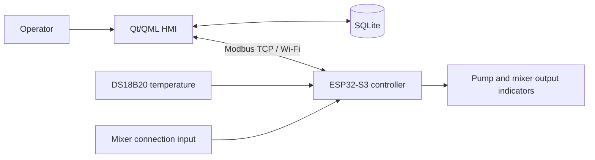

# Lukasz Citko | C++ / Qt / Embedded Systems Portfolio

This repository presents software projects focused on C++, Qt/QML, embedded controllers, industrial process interfaces, and testable application architecture. Each project contains its own source code, build instructions, tests, and technical documentation.

## Featured project

### [MixingStationHMI](projects/MixingStationHMI/)

MixingStationHMI is a distributed batch-control prototype with a Qt/QML operator interface and an ESP32-S3 process controller. The HMI communicates with the controller over Modbus TCP through Wi-Fi, stores run history and trends in SQLite, and presents process state, equipment status, alarms, and recovery information on a 1280 x 800 touch-oriented interface.

The project can also run without hardware using its desktop simulation mode.

**[Watch the 90-second Raspberry Pi and ESP32 hardware demonstration](https://github.com/LukaszCitko/QtPortfolio/releases/download/v2.1.0/MixingStationHMI-v2.1-demo.mp4)**

**Technology stack:** C++17, Qt 6, QML, Qt SerialBus, SQLite, CMake, ESP-IDF 6.1, FreeRTOS, Modbus TCP, GPIO, DS18B20, Qt Test, Unity, and GitHub Actions.

**What the project demonstrates:**

- A process state machine shared through an explicit 16-bit Modbus register protocol.
- A Qt client that polls controller snapshots, sends sequenced commands, reconnects, and detects controller restarts.
- ESP32-S3 firmware with FreeRTOS tasks, Wi-Fi, Modbus TCP, GPIO outputs, a physical mixer-presence input, and a DS18B20 temperature sensor.
- A touch-oriented HMI based on high-performance HMI principles, with restrained colour and prominent abnormal-state indication.
- SQLite persistence for operators, runs, events, and historical trend samples.
- Role-aware batch control, fault reset, drain control, and demo user management.
- Automated Qt and firmware builds in CI, host-side Qt tests, and ESP-IDF Unity component tests.

[Project overview and build instructions](projects/MixingStationHMI/README.md) | [Illustrated system guide](projects/MixingStationHMI/docs/MixingStationHMI-Guide.pdf) | [Qt/C++ source](projects/MixingStationHMI/src/) | [ESP32 firmware](projects/MixingStationHMI/firmware/mixing_controller/) | [Tests](projects/MixingStationHMI/tests/)

## Project status

The hardware prototype has been exercised with an ESP32-S3, physical temperature input, GPIO status indicators, fault indication, Modbus TCP communication, reconnect handling, and run persistence. It remains a portfolio and learning system: its LEDs represent actuator commands, process volume is currently simulated in firmware, and it has not undergone production safety validation.

## License

The original code and documentation in this repository are available under the [MIT License](LICENSE). Third-party frameworks, ESP-IDF components, and Qt remain subject to their own licences.
