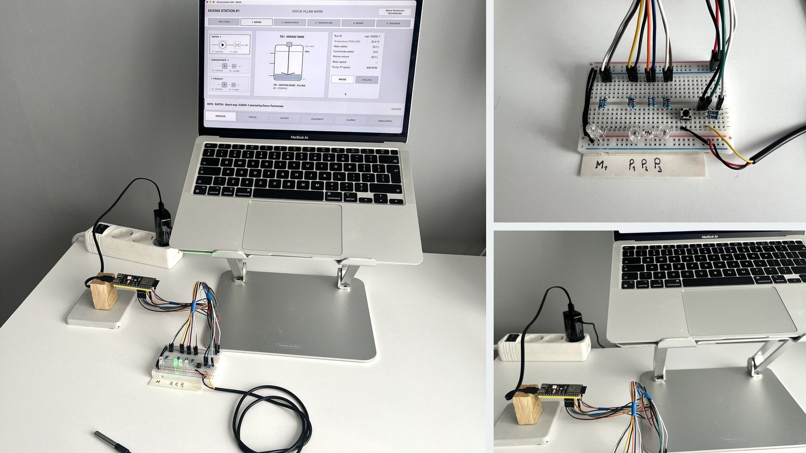
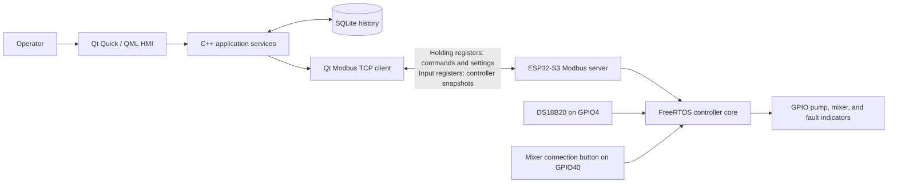
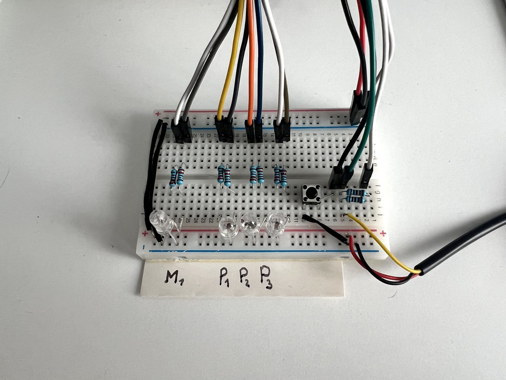
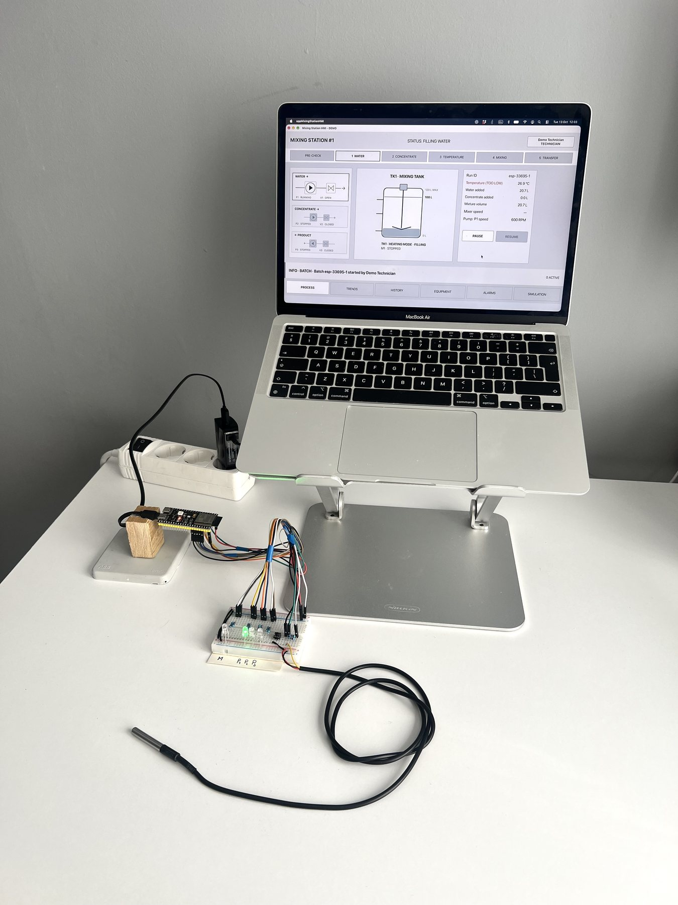
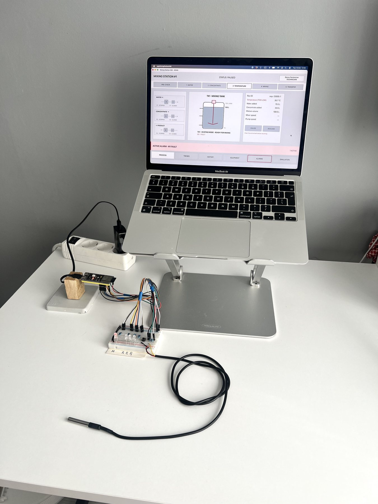
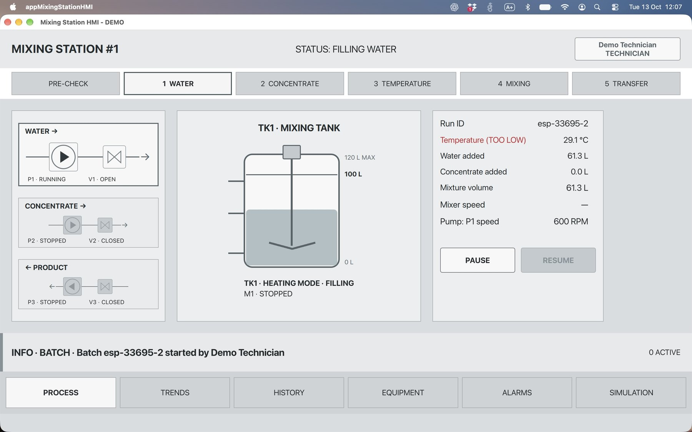
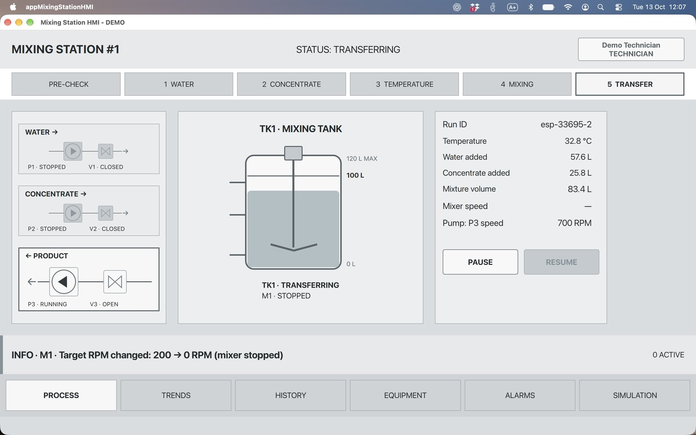
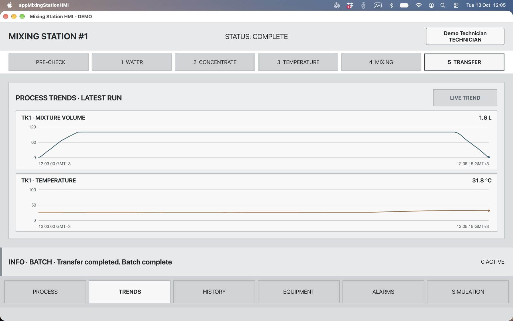
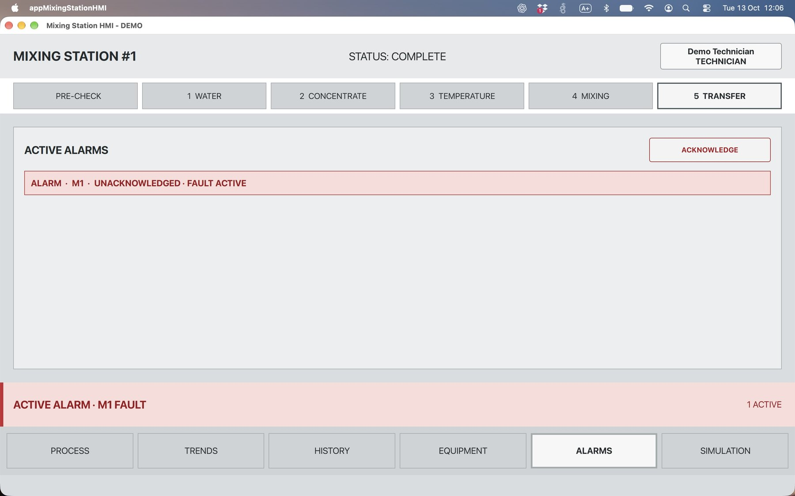

# MixingStationHMI

[](https://github.com/LukaszCitko/QtPortfolio/actions/workflows/mixingstation-ci.yml)

A distributed batch mixing station prototype built with a Qt/QML HMI and an ESP32-S3 controller. The HMI communicates with the controller over Modbus TCP through Wi-Fi, records process history in SQLite, and can also run as a self-contained desktop simulation.



[Open the illustrated system guide](docs/MixingStationHMI-Guide.pdf) | [Browse selected screenshots](docs/screenshots/) | [Review follow-up work](docs/TODO.md)

## Current capabilities

- **Batch sequence:** pre-check, 70 L water filling, 30 L concentrate dosing, temperature validation at 30-36 C, 8 seconds of mixing, operator-approved transfer, and preparation for the next batch.
- **Two operating modes:** local Qt simulation or a remote ESP32-S3 controller selected with `--controller-host`.
- **Process communication:** Modbus TCP server on the ESP32 and a Qt SerialBus client using port 1502.
- **Controller identity:** a controller session ID and run sequence create stable run IDs such as `esp-33695-1`.
- **Command handling:** sequenced commands, acknowledgements, duplicate protection, state validation, reconnect attempts, and snapshot polling.
- **Physical prototype:** DS18B20 temperature input, mixer connection button, pump/mixer output LEDs, and separate fault LEDs.
- **Fault behaviour:** faults pause the batch, remain active until reset, appear in the HMI and on physical fault indicators, and are recorded in History.
- **Recovery:** an ESP32 restart during an active run marks the run as `INTERRUPTED` and blocks a new batch until recovery is explicitly completed.
- **Persistence:** SQLite stores users, runs, events, and trend samples. History can be filtered by run and can display saved trends.
- **Roles:** operator, technician, and admin permissions cover batch actions, resets, drains, and demo user management. The current login is a role-selection demonstration without authentication.

## System architecture



The HMI owns presentation, operator sessions, history, trends, and user management. The ESP32 owns the active batch state machine, equipment command state, process timing, temperature validation, and Modbus register bank. Losing the HMI connection does not stop the controller task; reconnecting restores the current snapshot.

The shared files in `shared/` define the protocol and process constants used by both sides. Register values are 16-bit integers. Physical quantities are scaled before transmission, for example temperature in tenths of a degree Celsius, volume in decilitres, and stage progress in permille.

## Operating modes

### Desktop simulation

Start the HMI without arguments. `BatchController` and `ProcessSimulator` run inside the Qt application, so no controller hardware is required.

```sh
./build/cli-debug/appMixingStationHMI
```

On macOS:

```sh
open -n build/cli-debug/appMixingStationHMI.app
```

### ESP32 hardware mode

Start the application with the controller IP address. The local process simulator is disabled and the HMI synchronizes its device models from Modbus snapshots.

```sh
./build/cli-debug/appMixingStationHMI --controller-host <IP adress>
```

On macOS:

```sh
open -n build/cli-debug/appMixingStationHMI.app --args --controller-host <IP adress>
```

The address is assigned by the local network and may change after reconnecting the controller.

## Prototype hardware

The current breadboard demonstrates commands and feedback without connecting real pumps or a mixer.

| Function | ESP32-S3 pin | Prototype representation |
| --- | ---: | --- |
| P1 water pump command / fault | GPIO1 / GPIO6 | Green / red channels of the P1 dual-colour LED |
| P2 concentrate pump command / fault | GPIO2 / GPIO7 | Green / red channels of the P2 dual-colour LED |
| P3 transfer pump command / fault | GPIO42 / GPIO15 | Green / red channels of the P3 dual-colour LED |
| M1 mixer command / fault | GPIO41 / GPIO5 | Green / red channels of the M1 dual-colour LED |
| Mixer connection input | GPIO40 | Debounced push button using the internal pull-up |
| Tank temperature | GPIO4 | DS18B20 with two parallel 10 kOhm resistors from DATA to 3.3 V, providing a 5 kOhm pull-up |



The indicator board uses four common-cathode, three-lead dual-colour LEDs. Every green and red channel has its own 220 ohm series resistor, for eight resistors in total. The common cathodes and all input devices share the ESP32 ground.


Water, concentrate, and transfer volumes are currently calculated by the firmware simulation from elapsed time and pump RPM. The DS18B20 value and mixer connection input are physical. Valve states remain logical controller outputs. The hardware layer can later be replaced with real input/output drivers without changing the HMI protocol.

## HMI and process behaviour

The 1280 x 800 interface uses neutral equipment graphics and reserves strong colour for alarms, faults, and conditions requiring action. It provides:

- process stage overview and current values;
- tank, pump, valve, and mixer status;
- pump target and actual RPM;
- pause, resume, transfer, drain, and fault reset actions;
- alarm acknowledgement and direct navigation to faulty equipment;
- live trends and historical trends selected by run;
- persisted event history grouped by controller run ID;
- demo operator selection and admin user management.

| Hardware operation | Fault response |
| --- | --- |
|  |  |

### Desktop HMI in hardware mode

| Water filling | Transfer |
| --- | --- |
|  |  |

| Live trends | Active alarms |
| --- | --- |
|  |  |

## Build the Qt application

Requirements:

- Qt 6.8 or later with Qt Quick, Qt SQL, Qt SerialBus, and Qt SerialPort;
- CMake 3.16 or later;
- a C++17 compiler.

The application is developed locally with Qt 6.12 and is built in CI with Qt 6.8.3 to retain compatibility with the declared minimum version.

From the project directory:

```sh
cmake -S . -B build/cli-debug -DCMAKE_PREFIX_PATH="$HOME/Qt/6.12.0/macos" -DCMAKE_BUILD_TYPE=Debug -DBUILD_TESTING=ON
cmake --build build/cli-debug --parallel
ctest --test-dir build/cli-debug --parallel --output-on-failure
```

Replace `CMAKE_PREFIX_PATH` with the Qt installation on your machine. The application creates `mixingstation.sqlite` in the platform application-data directory and prints the exact path at startup.

The CMake project also builds:

- `appControllerSimulator`, a desktop Modbus TCP test server;
- `appModbusClientProbe`, a command-cycle and protocol probe;
- the HMI application and 19 Qt test executables.

## Build and flash the ESP32-S3 firmware

Requirements:

- ESP-IDF 6.1;
- an ESP32-S3 development board;
- a USB data cable;
- access to a 2.4 GHz Wi-Fi network.

Activate ESP-IDF and enter the firmware project:

```sh
source "$HOME/.espressif/v6.1/esp-idf/export.sh"
cd firmware/mixing_controller
idf.py set-target esp32s3
idf.py menuconfig
```

In the top-level **Mixing Station Wi-Fi** menu, enter the network name and password. ESP-IDF writes them to the local `sdkconfig`, which is excluded from Git.

Build and flash:

```sh
idf.py build
idf.py -p /dev/cu.usbmodemXXXXXXXX flash monitor
```

Replace the serial port with the one reported by your system. Leave the monitor with `Ctrl+]`. After connecting, the controller prints its IP address and starts the Modbus TCP server on port 1502.

Build the firmware test application:

```sh
idf.py -C test fullclean build
```

Run the Unity component tests on the board:

```sh
idf.py -C test -p /dev/cu.usbmodemXXXXXXXX flash monitor
```

## Testing and CI

GitHub Actions runs two independent Linux jobs on every relevant push and pull request:

1. configure and build the Qt application, then execute the Qt test suite with CTest;
2. build the ESP32-S3 firmware and its ESP-IDF test application using the official Espressif CI action.

The test coverage includes process transitions, faults, pause/resume behaviour, temperature gating, transfer and drain behaviour, permissions, repositories, trends, Modbus mapping, command sequences, and firmware process simulation. Hardware Unity tests are additionally run on the physical ESP32-S3 during development.

## Repository structure

```text
MixingStationHMI/
|-- qml/                         Qt Quick operator interface
|-- src/                         HMI domain objects and services
|   |-- communication/           Modbus client and remote controller adapter
|   `-- database/                SQLite schema, repositories, and list models
|-- shared/                      Protocol and process configuration shared by Qt and ESP-IDF
|-- firmware/mixing_controller/  ESP32-S3 FreeRTOS firmware and Unity tests
|-- tests/                       Qt Test suite
`-- docs/                        Guide, screenshots, and follow-up work
```

## Scope and follow-up work

This is a portfolio prototype, not a production machine controller. The breadboard LEDs represent equipment outputs; it has no contactors, motor drives, emergency-stop circuit, physical level/flow sensors, or certified safety functions. Demo users are selected without passwords, cards, or chips.

Planned work is tracked in [docs/TODO.md](docs/TODO.md), including physical level and pump feedback, stronger recovery rules, persistence of recovery state, connection-event refinement, and optional network diagnostics.

## License

This project is licensed under the [MIT License](../../LICENSE). Qt, ESP-IDF, and managed third-party components remain subject to their applicable licensing terms.
